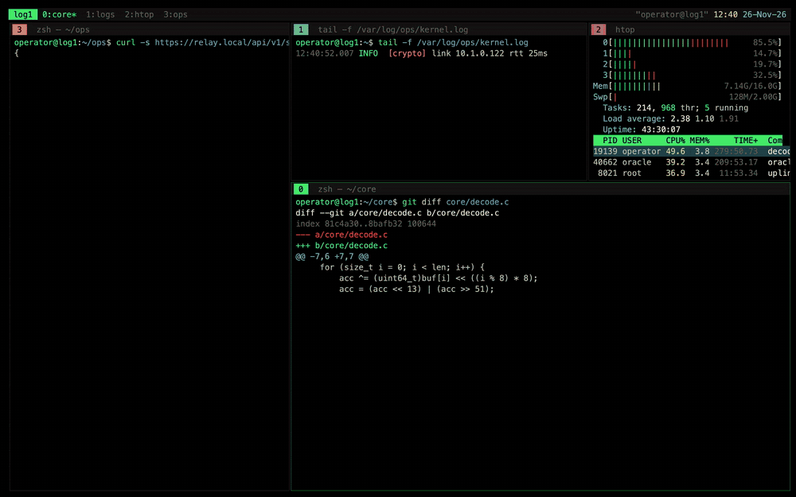
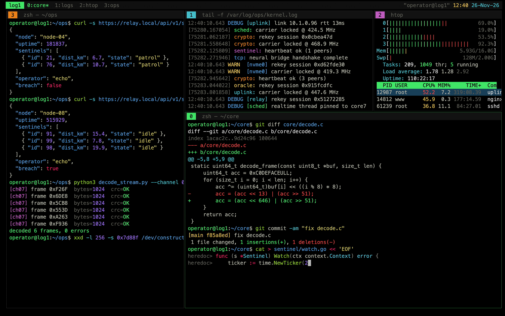
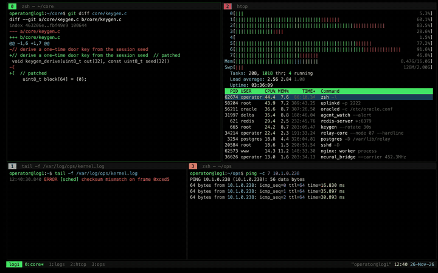
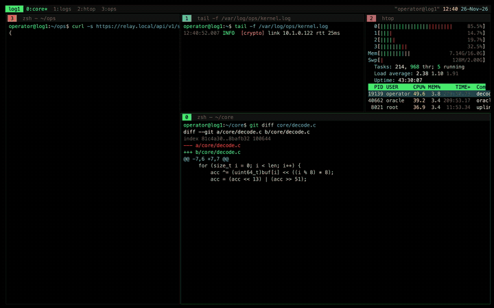
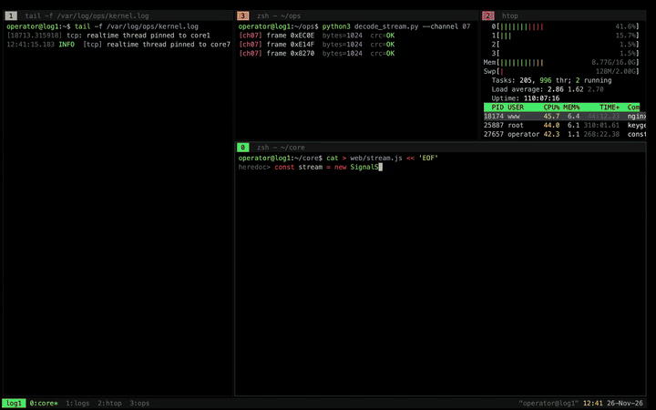
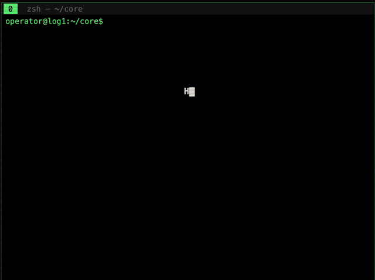
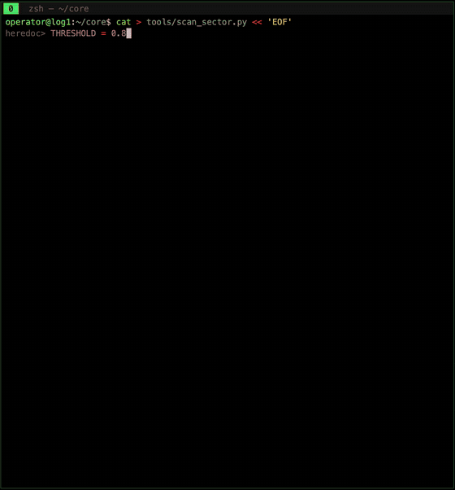
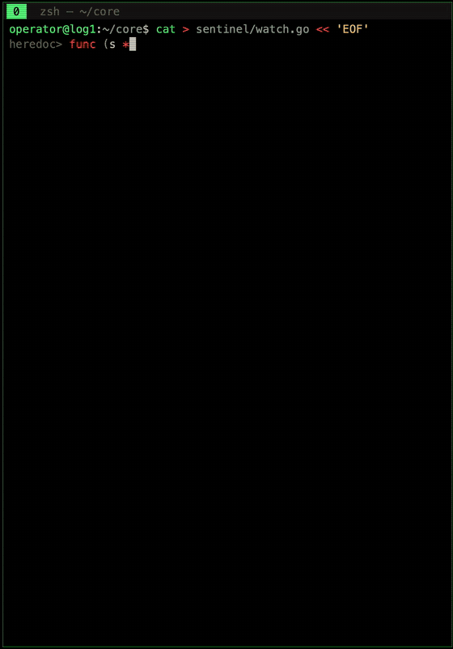
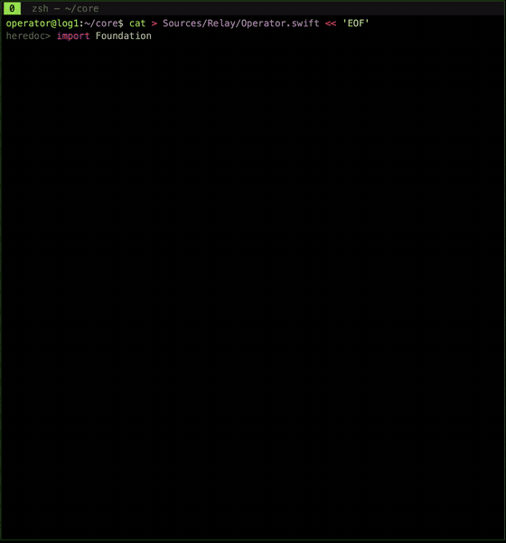
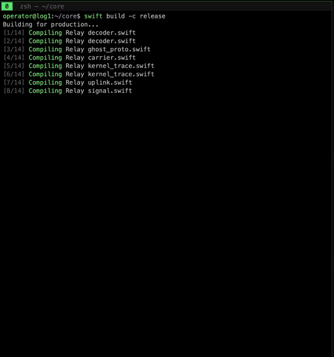

<!-- GitHub 저장소 첫 화면(설명 페이지)용. images/ 폴더의 사진·GIF는 배포판으로 직접 촬영해서 교체 -->

  

<h1 align="center">Operator Terminal</h1>

  <b>자리를 비운 사이, 누군가 당신의 맥에서 코딩을 시작합니다.</b> 
  <i>While you're away, someone starts coding on your Mac.</i>

  <a href="#다운로드--download"><b>⬇︎ 무료 다운로드 · Free Download</b></a>

---

## 소개 · About

화면이 넷으로 나뉜 터미널에서 코드가 쉴 새 없이 타이핑되고, 빌드 로그와 시스템 모니터가 흘러갑니다.
그러다 어느 순간 — 전화벨이 울리고, 화면이 해킹당합니다.

Four terminal panes fill your screen with live code, build logs and system monitors.
Then, out of nowhere, a phone rings — and your screen gets hacked.

- 🆓 **완전 무료** · Completely free
- 💻 **macOS 화면 보호기** · A native macOS screen saver
- 🔊 **효과음 직접 합성** (외부 음원 없음) · All sound effects are synthesized in code
- 🧩 **해킹 장면 8종** · 8 animated hacking scenes

---

## 기본 화면 · Default Screen

4분할 터미널이 각자 다른 작업을 합니다. 코드 작성, 실시간 로그, 시스템 모니터, 네트워크 스캔까지.
키워드는 빨강, 문자열은 노랑, 함수는 초록 — 진짜 코드 에디터처럼 색이 입혀집니다.

Four panes, four jobs: writing code, streaming logs, monitoring the system and scanning the network.
Syntax-highlighted like a real code editor.

---

## 해킹 장면 · Hacking Scenes

평화롭던 화면이 갑자기 점령당합니다. 큰 패널 안에서, 또는 화면 전체를 장악하며.

Without warning, the screen gets taken over — inside the main pane, or across the entire display.

| | |
|:---:|:---:|
|  **흰 토끼 · White Rabbit** 깡충깡충 뛰던 토끼가 굴속으로 사라집니다 *A rabbit hops across and dives into its hole* |  **지구 · Globe** 도시를 하나씩 뚫고, 마지막엔 서울로 *City after city falls — ending in Seoul* |
|  **시한폭탄 · Time Bomb** 10초 카운트다운, 해제 비밀번호는… 실패 *10-second countdown. The password… fails* |  **빨간 약, 파란 약 · Red Pill, Blue Pill** 어느 쪽을 고를지는 화면 보호기 마음 — 결말도 둘 *The screen saver picks one — two endings* |
|  **해골 · Skull** 턱을 딱딱거리며 SYSTEM COMPROMISED *Chattering jaw. SYSTEM COMPROMISED* |  **자물쇠 · Lock** 다이얼을 하나씩 맞춰 ACCESS GRANTED *Cracked digit by digit. ACCESS GRANTED* |
|  **바이러스 · Virus** 1 → 2 → 4 → 8, 감염률 100% *1 → 2 → 4 → 8. Infection 100%* |  **거미 · Spider** "버그 1개 발견." …"버그가 아니라 기능입니다." *"1 bug found." … "It's not a bug. It's a feature."* |

---

## 특징 · Features

| 한국어 | English |
|---|---|
| **메시지 연출** — 전화벨이 울리고 다른 화면이 멈추며 문구가 한 글자씩. 문구는 직접 바꿀 수 있어요 | **Incoming messages** — a phone rings, everything freezes, a message types out. Write your own |
| **표시 방식 선택** — 패널 안 / 전체 화면 / 섞어서 | **Display mode** — in-pane, full screen, or mixed |
| **장면·소리 개별 설정** — 장면마다 켜기·끄기, 소리도 따로 | **Per-scene control** — toggle each scene and its sound |
| **등장 빈도 조절** — 약 10분마다부터 1분마다까지 | **Adjustable frequency** — from every ~10 min to every minute |
| **화면 잔상 방지** — 5분마다 배치가 바뀌고 화면이 미세하게 움직여요 | **Burn-in friendly** — layouts rotate and the image slowly drifts |
| **구형 인텔 맥 배려** — 내장·외장 그래픽 전환 때 화면이 깨지지 않도록 설계 | **Kind to older Intel Macs** — designed to avoid glitches when switching GPUs |
| **인텔 · 애플 실리콘 모두 지원** | **Runs on both Intel and Apple Silicon** |

---

## 다운로드 · Download

**[⬇︎ Operator Terminal 최신 버전 받기 · Get the latest version](../../releases/latest)**

- macOS 11 Big Sur 이상 · macOS 11 Big Sur or later
- 파일 · File: `OperatorTerminal-1.0.dmg`

---

## 설치 · Install

1. 받은 `OperatorTerminal-1.0.dmg`를 엽니다.
   Open `OperatorTerminal-1.0.dmg`.
2. **Operator Terminal Installer**(설치 도우미)를 열고 **설치**를 누릅니다.
   Open **Operator Terminal Installer** and click **Install**.
3. 시스템 설정 → 화면 보호기에서 **Operator Terminal**을 고릅니다.
   Choose **Operator Terminal** in System Settings → Screen Saver.

### ⚠️ "확인되지 않은 개발자" 경고가 뜰 때 · If macOS blocks it

개인이 만든 무료 프로그램이라 Apple 서명이 없어서 처음 한 번 경고가 뜹니다.

This is a free app by an individual developer without an Apple signature, so macOS warns you once.

1. 경고 창에서 **완료**를 누릅니다. · Click **Done** on the warning.
2. **시스템 설정 → 개인정보 보호 및 보안**으로 갑니다. · Open **System Settings → Privacy & Security**.
3. 아래쪽 보안 항목의 **그래도 열기**를 누르고 암호를 입력합니다. · Click **Open Anyway** and enter your password.

<!-- 실제 경고 창·설정 화면 캡처를 넣으면 훨씬 친절해집니다 -->
<!--  -->

---

## 옵션 · Options

시스템 설정 → 화면 보호기 → Operator Terminal → **옵션…**

System Settings → Screen Saver → Operator Terminal → **Options…**

<!-- 옵션 창 캡처를 넣으려면:  -->

| 탭 · Tab | 설정 · Settings |
|---|---|
| 일반 · General | 시작 시간, 메시지 유지 시간 · Start time, message hold time |
| 문구 · Messages | 등장 문구 4개, 빈도 · Four custom messages, frequency |
| 소리 · Sound | 효과음 5종, 볼륨 (기본 꺼짐) · Five sound effects, volume (off by default) |
| 해킹 · Hacking | 장면·소리 켜기/끄기, 빈도, 표시 방식 · Scenes, sounds, frequency, display mode |

---

## 제거 · Uninstall

마음에 들지 않으면 언제든 깔끔하게 지울 수 있어요.

You can remove it cleanly at any time.

- **옵션 → 제거…** 버튼 · **Options → Uninstall…** button
- 또는 **설치 도우미 → 제거** · or **Installer → Uninstall**
- 또는 시스템 설정 → 화면 보호기에서 썸네일을 Control(⌃)+클릭 → **삭제**
  or Control(⌃)-click its thumbnail in System Settings → Screen Saver → **Delete**

---

## 자주 묻는 질문 · FAQ

**소리가 안 나요. · I can't hear anything.**
소리는 기본으로 꺼져 있어요. 옵션 → 소리 탭에서 **소리 켜기**를 체크하세요.
Sound is off by default. Turn on **Enable sound** in Options → Sound.

**모니터가 여러 대예요. · I use multiple monitors.**
화면마다 따로 돌아가고, 소리는 메뉴 막대가 있는 화면에서만 납니다.
Each display runs on its own; sound plays only on the display with the menu bar.

**배터리를 많이 쓰나요? · Does it drain the battery?**
그래픽 카드 대신 CPU로 가볍게 그리도록 만들었어요. 화면 보호기가 꺼지면 완전히 멈춥니다.
It draws lightly on the CPU instead of the GPU, and stops completely when the screen saver ends.

---

## 안내 · Notice

Operator Terminal은 **MuhanSari**가 만든 무료 프로그램입니다. 특정 영화·회사와 관련이 없습니다.
화면에 나오는 코드와 로그, 해킹 장면은 모두 연출이며 실제로 아무것도 해킹하지 않습니다. 😉

Operator Terminal is a free app made by **MuhanSari**. It is not affiliated with any film or company.
All code, logs and hacking scenes are just for show — nothing is actually hacked. 😉

**문의 · Contact** — burns1009@naver.com
